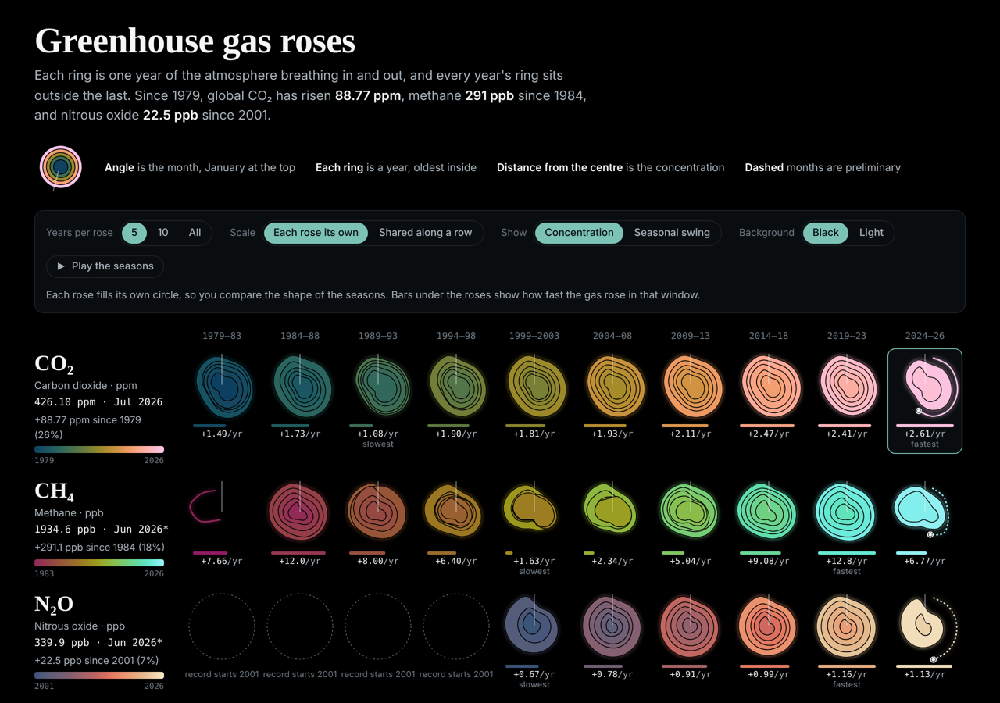

<p align="center">
  <a href="https://sarah-cleo.github.io/climate-dashboard/"></a>
</p>

<p align="center">
  <a href="https://sarah-cleo.github.io/climate-dashboard/"></a>
  &nbsp;
  <a href="retrieval/"></a>
</p>

<p align="center"><sub>Living portraits of a changing climate · guided by the GCOS Essential Climate Variables · NOAA and NASA data · Python retrieval scripts and notebooks</sub></p>

---

## What it is

A growing set of interactive climate dashboards, drawn from open data and guided by the [GCOS Essential Climate Variables](https://gcos.wmo.int/site/global-climate-observing-system-gcos/essential-climate-variables).

The first dashboard, **Greenhouse gas roses**, shows carbon dioxide, methane and nitrous oxide as rose plots. Angle is the month, each ring is one year, and distance from the centre is the concentration, so every year's ring sits a little outside the last. You can rescale the roses, hover a year, open a rose with NOAA's uncertainty, and read a short guide to where the air was sampled and where the trends are heading.

[**Open the live dashboard →**](https://sarah-cleo.github.io/climate-dashboard/)



## What's here

```
docs/                                   the website (GitHub Pages serves this folder)
├── index.html                          landing page, with a live ticking CO₂ rose
├── dashboard/greenhouse-gas-roses.html the Greenhouse gas roses dashboard
├── preview.png, favicon.svg
└── .nojekyll                           tells GitHub Pages to serve the files as they are
retrieval/
├── download_climate_data.py            downloads every data file, by Essential Climate Variable
├── get_climate_data.py                 the simple first script (four core files)
├── climate_dashboard_data.ipynb        the notebook that retrieved the data, with preview plots
└── climate_data_download.ipynb         the first notebook (four core files)
data/                                   the data files, exactly as published
assets/                                 README banner, buttons and social preview image
```

## Publish the site with GitHub Pages

1. Make sure `docs/`, `retrieval/`, `data/`, `assets/` and this `README.md` sit at the top level of the repository, not inside another folder.
2. In the repository, open **Settings → Pages**.
3. Under **Build and deployment**, choose **Deploy from a branch**, pick the branch `main` and the folder **`/docs`**, then press **Save**.
4. After a minute or two, the **Actions** tab shows a green *pages build and deployment* run. The site is then live at **https://sarah-cleo.github.io/climate-dashboard/**.
5. Optional finishing touches:
   - Next to **About** on the repository page, click the gear and tick **Use your GitHub Pages website**.
   - Under **Settings → General → Social preview**, upload `assets/social-preview.png`.

If your repository has a different name than `climate-dashboard`, replace `sarah-cleo/climate-dashboard` in two places: the links at the top of this README, and the retrieval links in `docs/index.html`.

## Get the data

All retrieval code uses only Python's standard library, except the chlorophyll step, which also needs `xarray` and `netCDF4`.

```bash
python3 retrieval/download_climate_data.py   # everything, saved into data/
python3 retrieval/get_climate_data.py        # just CO₂, methane, N₂O and NASA temperature
```

Each download is checked before it replaces a file: an error page or an empty reply is rejected and the old copy is kept. To skip a file or switch one on, set `get=True` or `get=False` in the settings at the top of `download_climate_data.py`.

The notebooks do the same work in [Google Colab](https://colab.research.google.com) or Jupyter (**File → Upload notebook**, then **Runtime → Run all**). They also show preview plots and bundle the files into one zip.

## The data

| File in `data/` | What it is | Source | Coverage |
| --- | --- | --- | --- |
| `co2_mm_gl.csv` | Global monthly mean CO₂ (ppm), with uncertainty and trend | [NOAA GML](https://gml.noaa.gov/ccgg/trends/global.html) | Jan 1979 to Jul 2026 |
| `ch4_mm_gl.csv` | Global monthly mean methane (ppb), with uncertainty and trend | [NOAA GML](https://gml.noaa.gov/ccgg/trends_ch4/) | Jul 1983 to Jun 2026 |
| `n2o_mm_gl.csv` | Global monthly mean nitrous oxide (ppb), with uncertainty and trend | [NOAA GML](https://gml.noaa.gov/ccgg/trends_n2o/) | Jan 2001 to Jun 2026 |
| `co2_mm_mlo.csv` | Mauna Loa monthly CO₂ (ppm) | [NOAA GML and Scripps](https://gml.noaa.gov/ccgg/trends/data.html) | Mar 1958 to Sep 2026 |
| `AGGI_Table.csv` | Warming effect (radiative forcing, W m⁻² since 1750) by gas, and the Annual Greenhouse Gas Index | [NOAA AGGI](https://gml.noaa.gov/aggi/aggi.html) | 1979–2025 |
| `GLB.Ts+dSST.csv` | Global monthly temperature anomaly (°C vs 1951–1980) | [NASA GISS GISTEMP v4](https://data.giss.nasa.gov/gistemp/) | Jan 1880 to Oct 2026 |
| `NH.Ts+dSST.csv`, `SH.Ts+dSST.csv` | Northern and Southern Hemisphere monthly anomalies | NASA GISTEMP v4 | Jan 1880 to Oct 2026 |
| `ZonAnn.Ts+dSST.csv` | Annual anomalies by latitude band | NASA GISTEMP v4 | 1880–2025 |

The NOAA global means come from weekly flask samples at remote marine boundary layer sites in NOAA's Global Greenhouse Gas Reference Network, all measured in Boulder, Colorado. NOAA writes `-9.99` where it has not yet calculated an uncertainty (its newest months), and the dashboard treats those months as preliminary. NOAA notes that the most recent year's values may still change slightly.

## Notes

- The dashboard is a snapshot of the NOAA files created on 9 October 2026. Re-running the retrieval updates `data/`, but not the dashboard page itself, which carries its own copy of the numbers.
- A few sentences in the dashboard's written section quote NOAA, NASA and WMO statements as of November 2026: the official 2025 growth rates, the October 2026 temperature anomaly and the El Niño outlook. Review them when the data moves on.
- No chlorophyll files are included yet: the chlorophyll step did not return data on its first run.
- The banner and buttons are SVG images with their lettering drawn as outlines, so they look the same on every screen. GitHub plays the banner's ticking hand in the README; the fully interactive version is the live site.

## Credits and citation

Please cite the data as NOAA asks:

- Lan, X., Tans, P. and K.W. Thoning: Trends in globally-averaged CO₂ determined from NOAA Global Monitoring Laboratory measurements. https://doi.org/10.15138/9N0H-ZH07
- Lan, X., K.W. Thoning and E.J. Dlugokencky: Trends in globally-averaged CH₄, N₂O, and SF₆ determined from NOAA Global Monitoring Laboratory measurements. https://doi.org/10.15138/P8XG-AA10
- Mauna Loa CO₂: Dr. Xin Lan, NOAA/GML, and Dr. Ralph Keeling, Scripps Institution of Oceanography.
- NOAA Global Monitoring Laboratory, The NOAA Annual Greenhouse Gas Index (AGGI). https://gml.noaa.gov/aggi/aggi.html
- GISTEMP Team, NASA Goddard Institute for Space Studies: GISS Surface Temperature Analysis (GISTEMP), version 4. https://data.giss.nasa.gov/gistemp/

Colour: Fabio Crameri's Scientific Colour Maps (batlow, hawaii, lipari). Type: Fraunces and IBM Plex (SIL Open Font License).

## License

No license has been chosen yet. Add one before inviting others to reuse the code. The data keep their providers' terms of use; NOAA and NASA make them freely available and ask for credit.
